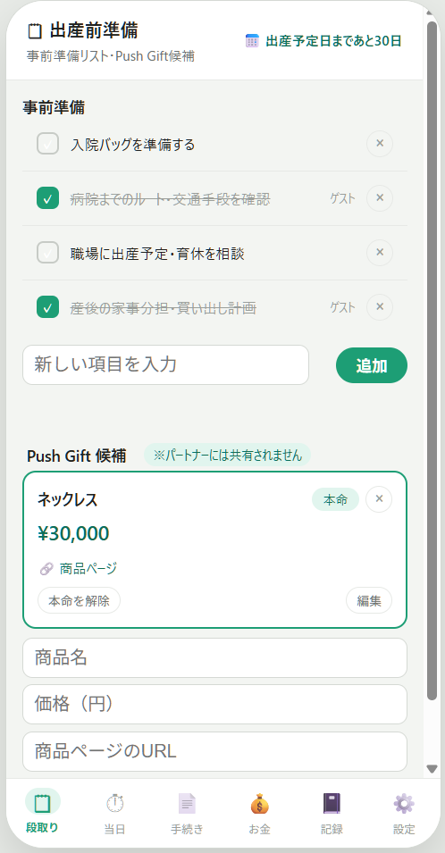
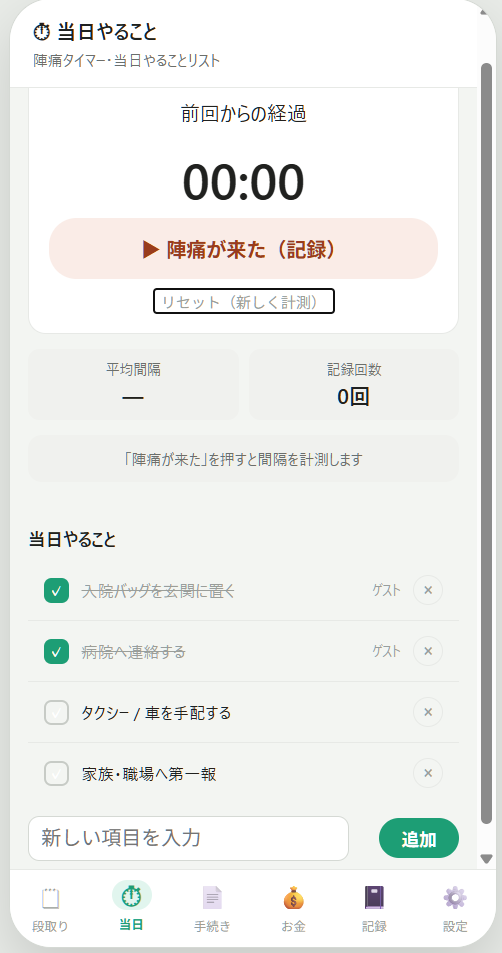
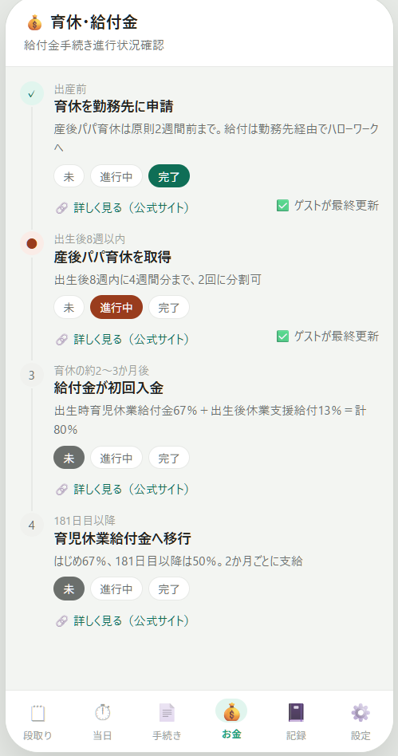
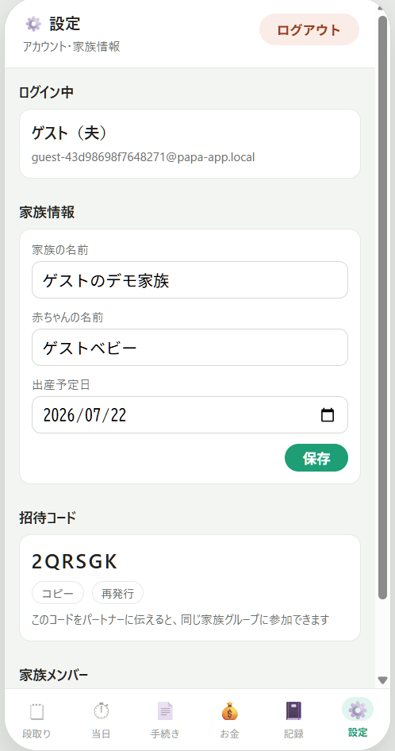
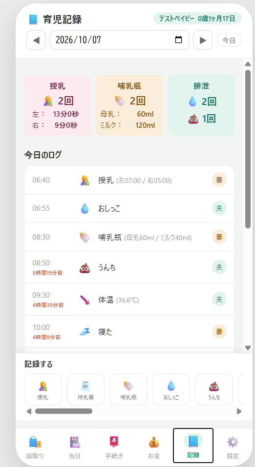
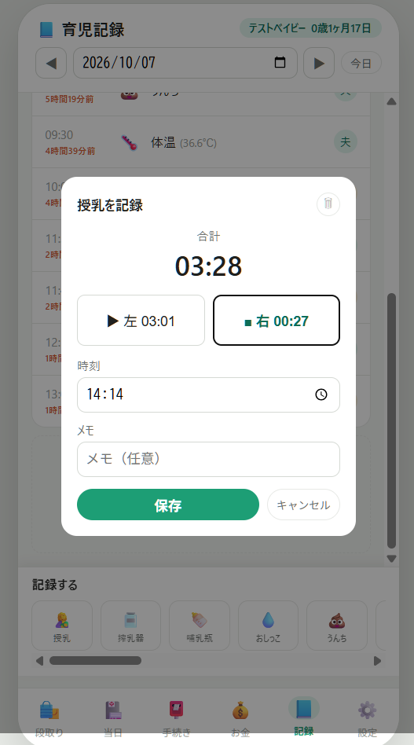
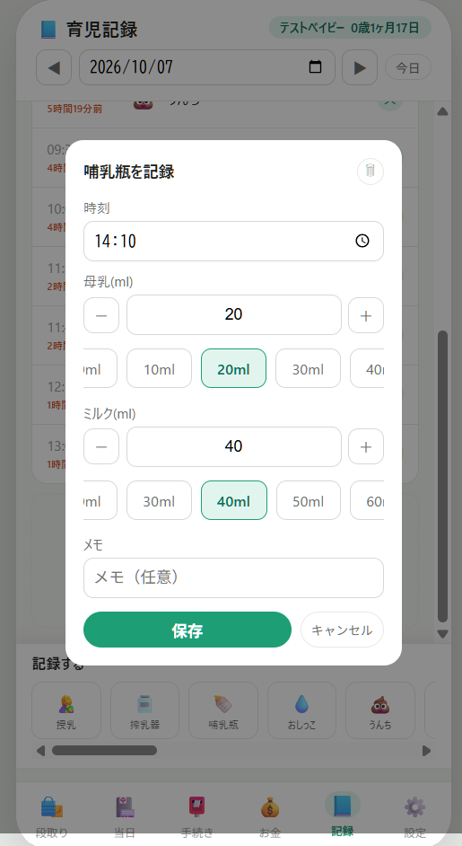
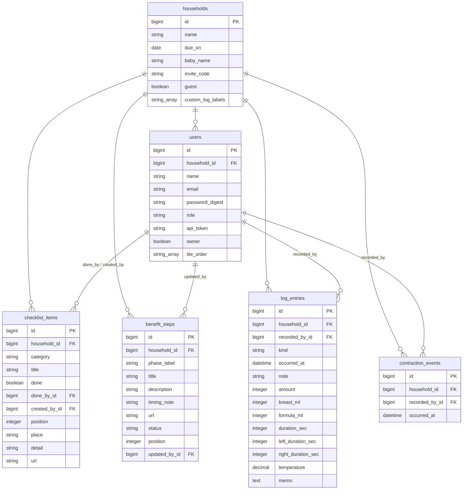

# 出産前後 パパアプリ（papa_app）

夫が「いつ・何をすべきか」で迷わないよう、出産前後の**段取り・当日対応・行政手続き・育休給付金・育児記録**を、夫婦二人三脚で管理できるアプリです。招待コードで同じ家族グループに入ると、お互いの操作(チェック済み・記録の追加など)が共有されます。

> 弟が父親になる中で、「何を・いつ・誰がやるか」が夫婦間で曖昧なまま出産を迎えることへの不安から着想しました。行政手続きの複雑さと、陣痛時のパニックの中でも迷わず動けることを重視して設計しています。実際の利用者である弟の意見を都度取り入れながら、小さな機能単位で「提案→実装→フィードバック反映」を繰り返すアジャイル的な進め方で改善を続けています。

---

## 📌 デモ / 動作確認

- **デプロイURL**: https://papa-app.kazkaz9717.com/
- **ゲストログイン**: ログイン画面の「ゲストログイン」ボタンから、登録不要ですべての機能をお試しいただけます。押すたびに使い捨てのデモアカウント(サンプルデータ入り)が発行され、24時間後に自動で削除されます。

---

## 🖼 スクリーンショット

| 段取り・準備 | 当日(陣痛タイマー) |
| :---: | :---: |
|  |  |

| 育休・給付金 | 設定・家族招待 |
| :---: | :---: |
|  |  |

### 育児記録

| 記録の一覧 | 授乳(左右タイマー) | 哺乳瓶(スクロール式の量入力) |
| :---: | :---: | :---: |
|  |  |  |

---

## ✨ 主な機能

### 段取り・準備
- 妊娠後期の事前準備チェックリスト(入力・完了トグル・削除)
- パートナーには共有されない非公開の「Push Gift候補」(出産のねぎらいとして贈るプレゼントの候補リスト)。商品名・価格・URLを登録し、価格は自動でカンマ区切り整形

### 当日対応
- 陣痛タイマー：「陣痛が来た」を押すたびに間隔を記録し、平均間隔・記録回数を自動集計。間隔が目安に近づくと「病院に電話」アラートを表示
- 当日やることチェックリスト

### 出産手続き
- 出生届・児童手当・出産育児一時金などの届出チェックリスト。提出先・補足・公式リンク付き

### 育休・給付金
- 産後パパ育休〜育児休業給付金の流れをタイムライン表示し、ステップごとに「未・進行中・完了」を管理

### 育児記録
- **多種のログ記録**：授乳(左右タイマー)・哺乳瓶(母乳/ミルク)・搾乳器・排泄・睡眠・飲み物・離乳食・ごはん・おやつ・体温・くすり・鼻水・発熱・吐くなど18種類のタイルから1タップで記録
- **授乳の左右タイマー**：左右どちらか一方のみ計測する排他制御つきで、1回の授乳を左右の秒数ごと1件として保存
- **量入力のスクロール式プリセット**：量(ml/g)を横スクロールのチップから選択でき、±ボタン・直接入力と連動して選択位置が追従。体温は±0.1ボタンで増減
- **サマリーパネル**：授乳(回数・左右の合計時間)・哺乳瓶(回数・母乳/ミルク量)・排泄(おしっこ/うんち回数)を1日分で集計
- **直近記録からの経過時間**：種類ごとの最新1件に「○時間○分前」を表示(今日の表示時のみ)
- **日付切り替え**：前日・翌日・今日ボタンと日付指定で過去のログを確認・編集・削除
- **カスタム項目**：家族共通で追加・削除でき、並び順も家族間で共有
- **タイルの並び替え**：長押しドラッグでユーザーごとに並び順を保存(SortableJS)
- **ログ下の空白タップ**：ログの下をタップすると全項目を3列グリッドで選べるポップアップを表示
- **赤ちゃんの名前・月齢表示**：ヘッダーに「名前 ○歳○ヶ月○日」を表示(出産予定日前は予定日までのカウントダウン)

### 設定・家族共有
- 家族の名前・赤ちゃんの名前・出産予定日/出生日の編集
- 招待コードでパートナーを同じ家族グループに招待、メンバー一覧・削除、招待コードの再発行

### 認証・ゲストログイン
- `has_secure_token` によるBearerトークン認証
- 招待コードを使った家族単位のマルチユーザー(夫婦間共有)
- ゲストログイン：呼び出すたびに使い捨ての家族・ユーザーを生成し、初期データ入りで即座に試用可能。Coolifyのスケジュールタスクで毎日、作成から24時間経過したゲストデータを自動削除

---

## 🛠 使用技術

| 分類 | 技術 |
| --- | --- |
| 言語 | Ruby 3.3.3 / JavaScript |
| フレームワーク | Ruby on Rails 7.2.3(`ActionController::API`) |
| データベース | PostgreSQL |
| フロントエンド | HTML / CSS(独自実装)/ Vanilla JavaScript / SortableJS(並び替えのみ) |
| 認証 | bcrypt(`has_secure_password`)＋ `has_secure_token` によるAPIトークン |
| インフラ | Docker(Rails標準Dockerfile)＋ [Coolify](https://coolify.io/)によるセルフホストデプロイ、Let's Encrypt(HTTPS) |
| バージョン管理 | Git / GitHub |

> フロントエンドはフレームワークを使わず、タブ切り替え・API通信・DOM描画をVanilla JavaScriptで実装しています。

### 技術選定の理由
- **Rails API + Vanilla JavaScript**: 画面とAPIの責務を分けて、HTTP・認証・状態管理を自分の手で理解することを目的にしました。フレームワークに隠れがちなfetch通信やDOM描画を、あえて自前で実装しています。
- **SortableJS**: 当初は自前のPointer Eventsで長押しドラッグを実装しましたが、スマホの横スクロールと競合して動作しなかったため、実績のあるライブラリに置き換えました。
- **セルフホスト(Coolify)**: デプロイ・HTTPS化・定期バッチまで自分で運用経験を持つため、PaaSではなくVPSを選びました。

---

## 🗄 ER図



| リレーション | 種類 | 説明 |
| --- | --- | --- |
| households → users | 1対多 | 1つの家族に夫婦(複数ユーザー)が所属 |
| households → checklist_items 等 | 1対多 | 家族が削除されると関連データも `dependent: :destroy` で連動削除 |
| users → checklist_items | 1対多(2経路) | 「誰が完了にしたか」「誰が作成したか」を別々の外部キーで保持 |
| users → log_entries | 1対多 | 「誰が記録したか」を保持し、ログ一覧に夫/妻のバッジとして表示 |

---

## 💡 実装上の工夫

### 家族単位のデータ共有とアクセス制御
招待コードを起点に、夫婦を同じ`Household`に紐づける設計にすることで、片方の操作(チェック完了・記録追加)がもう片方にも共有される仕組みをシンプルなAPI設計で実現しました。

### 完了操作の誤操作防止
チェック済みの項目を未完了に戻す操作は、パートナーが完了させたものを誤って取り消さないよう確認ダイアログを挟み、かつ「誰が完了にしたか」を表示することで意図しない上書きを防いでいます。

### 陣痛タイマーの集計ロジック
記録のたびに平均間隔を再計算し、目安の間隔に近づいたら自動でアラート表示を切り替える設計にすることで、当日パニックになりがちな場面でも判断材料をシンプルに提示できるようにしました。

### 授乳データの1エントリ化
当初は左・右を別々のログとして保存していましたが、集計時の「回数」の解釈が曖昧になり、表示も煩雑になっていました。`log_entries`に`left_duration_sec`/`right_duration_sec`カラムを追加して「1回の授乳＝1レコード」に統合し、回数は1エントリ＝1回、時間は左右それぞれの合計として集計する設計に整理しました。

### kindとカラムによる記録種別の拡張
記録の種類(`kind`)を文字列で持たせ、量・時間・体温など種別ごとに必要なカラムだけを使う設計にしました。新しい記録種別の追加がモデルの`KINDS`と画面側の定義追加だけで済み、機能追加を小さく回せます。

### 出産予定日と出生日を1項目で扱う
「出産予定日」と「出生日」を別項目にすると、早産やテスト利用など入力のタイミングで矛盾が生じるため、`due_on`1本で管理して、設定画面のラベルを「出産予定日 / 出生日」とする設計を採用しました。この日付を基準に、生まれる前は予定日までのカウントダウン、生まれた後は「○歳○ヶ月○日」を表示します。

### 読み込み時のちらつき対策
ログイン画面や空のタブが一瞬見える現象に対し、認証画面を初期状態で非表示にして判定後に出し分け、最初に表示するタブのデータ取得だけを待ってから画面を表示する構成に変更しました。他タブのデータ取得は並行して先に走らせ、体感の待ち時間を増やさないようにしています。

---

## 🔧 苦労した点と解決策

### ブラウザのセキュアコンテキスト制約でクリップボードコピーが動かない
本番動作確認をIPアドレス＋HTTPのLAN環境で行っていたところ、招待コードの「コピー」ボタンが反応しない問題が発生。調査の結果、`navigator.clipboard.writeText()` はHTTPSまたはlocalhostでしか動作しないブラウザの仕様(セキュアコンテキスト制限)が原因と判明。本番はHTTPSで運用するため実害はないと判断しつつ、開発時とテスト時でAPIの利用可否が変わる点を学びました。

### 新機能デプロイ後にコンテナが起動直後にクラッシュループ
ゲストログイン機能の追加後、デプロイは成功と表示されるのにコンテナがすぐ`Exited`になる問題が発生。CoolifyのUI上の実行ログはコンテナが停止すると閲覧できなくなる仕様だったため、SSHで直接サーバーに入り`docker logs`でエラーを確認したところ、Rubyのモデルファイル内でメソッド定義が重複し、`end`が1つ不足する構文エラーが原因でした。UI経由のログだけに頼らず、必要に応じてサーバーへ直接アクセスして生のログを見に行く判断の重要性を学びました。

### ゲストデータの肥大化とプライバシーの両立
当初は固定の共有デモアカウント方式を検討しましたが、複数人が同時にゲスト体験すると互いのデータが混在してしまう問題に気づき、ログインのたびに使い捨てアカウントを新規発行する方式に変更しました。一方でこの方式はDBにレコードが際限なく溜まり続けるトレードオフがあるため、Coolifyのスケジュールタスク機能で「作成から24時間経過したゲストデータを毎日自動削除するバッチ」を追加し、体験の質とDBの健全性を両立させました。

### スマホで長押しドラッグの並び替えが動かない
タイルの並び替えを自前のPointer Eventsで実装したところ、PCでは動くのにスマホでは動作しませんでした。`touch-action`の調整を試しても改善せず、横スクロールするタイル一覧では「スクロール」と「長押しドラッグ」が同じ指の動きを取り合うことが原因と推測し、SortableJSに置き換えて解決しました。自前実装にこだわらず、課題に合ったライブラリへ切り替える判断を学びました。

### 量を入力するとメモが一覧に表示されない
ログ一覧の詳細表示が「量があればメモを出さない」条件分岐になっており、量とメモを両方入力するとメモだけが見えなくなっていました。種別ごとの表示文字列を配列に積んで結合する形に統一し、量・メモ・単位(ml/g)をすべて表示するようにしました。

---

## 🚀 ローカル環境での起動

```bash
# リポジトリをクローン
git clone https://github.com/kazkaz9717/papa_app.git
cd papa_app

# 依存パッケージをインストール
bundle install

# データベースを作成・初期化
rails db:create
rails db:migrate

# サーバーを起動
rails server
```

ブラウザで `http://localhost:3000` にアクセスし、ゲストログインからお試しください。

---

## 👤 制作者

- GitHub: [kazkaz9717](https://github.com/kazkaz9717)
